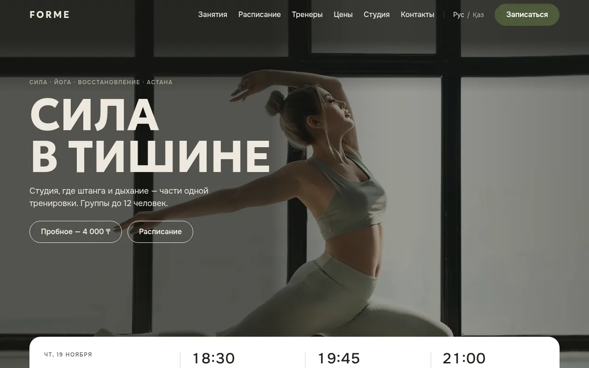

# FORME — концепт сайта студии тренировок

**Бизнес:** Демонстрационный сайт вымышленной студии FORME в Астане (пример работы, не реальный клиент).

## Задача
Показать, как мог бы выглядеть сайт студии: расписание, запись на пробное занятие, две языковые версии.

## Что сделано
- Главная, расписание и страница записи
- Русская версия и черновик казахской (перевод ещё не вычитан)
- Форма записи отправляет заявку в Telegram, а если не вышло, оставляет ссылку в WhatsApp
- Скрипты проверки на Playwright (навигация, меню, карта, казахский текст)

## Стек
Next.js 16, React 19, TypeScript, Tailwind CSS 4, ESLint, Playwright (для проверок). Фото — Unsplash и Pexels, список авторов в CREDITS.md.

## Примечание
Для отправки заявок нужны переменные окружения TELEGRAM_BOT_TOKEN и TELEGRAM_CHAT_ID. В репозитории их нет.

---
Сделано с помощью AI-инструментов (Cursor, AI-агенты) под моим руководством.
